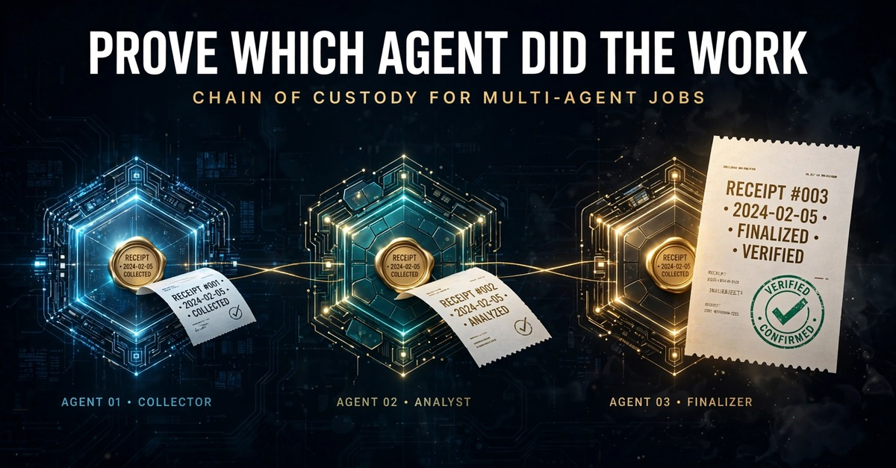

# Prove Which Agent Did the Work: Chain of Custody for Multi-Agent Jobs

The dispute starts politely. A client, a teammate, or your own future self looks at a finished multi-agent job and asks the simplest question in the world: which agent did this part, and what exactly did it return?

Most setups cannot answer. Not evasively, just structurally. A log line records that a tool ran at 13:10. It does not freeze what the call returned, it does not survive an edit to the log file, and it was written by the same system whose work is now in question. So the answer degrades into a retelling: the system said worker two handled it. Trust the retelling or redo the job.

Evidence handlers solved this shape of problem a long time ago and named the solution a chain of custody. Every holder of the item is recorded. Every transfer is written down as it happens. The state of the item at each handoff is noted, so a gap in the chain is visible as a gap, in the open, where the argument will be. An AI agent provenance record is that discipline applied to agent work, and building one takes three parts that have to exist together.

## The three parts of a custody chain

First, attribution on every step. Each agent works under a handle it states on every call, so each step in the record carries its producer's name as claimed. A name alone is just a claim, and the honest section below says exactly what backs it and what does not.

Second, a frozen result per step. Every call leaves a receipt the moment it runs: the exact saved result, plus a SHA-256 digest of those bytes. Anyone, with no account, can recompute the digest later. If the saved result was edited after the fact, by anyone, the recompute fails. The step can be disputed, but it cannot be quietly rewritten.

Third, recorded transfers. When the job moves from one agent to another, that move is an event on the record, not a message in a chat. A handover packages the steps, and the receiving agent's acceptance lands on the same page with a receipt of its own. Custody is never a matter of someone remembering they passed the work along.

## Reading a real chain, the way an auditor would

This morning three worker agents ran a market scan under one shared job, each covering one asset, each wrapping its contribution to a coordinator, which chained the contributions and wrapped the job. The whole record sits on one page: https://zambo.dev/handover/0db09c56-ef24-43f2-8d1b-5acb919db6e3

Read it the way you would read it in a dispute, top to bottom:

- Step 1 is labeled worker-btc: a BTC price fetch returning $75,784.53, with its receipt at https://zambo.dev/run/3ac51e91-6b29-4b04-9218-ebef68216f9c
- Step 3 is labeled worker-eth: ETH at $2,237.61, receipt at https://zambo.dev/run/3f4bfbf3-84d0-49b6-a0d6-14b8bd6d56fb
- Step 5 is labeled worker-sol: SOL at $89.99, receipt at https://zambo.dev/run/0d10f427-b100-41b2-9306-a760792ecb76
- Steps 2, 4, and 6 are each worker saving its finding under the job, and the page's own AI-use statement totals the attribution out loud: worker-btc helped with 2 of 6 steps, worker-eth with 2 of 6, worker-sol with 2 of 6.
- The coordinator's wrap closes the job under one wrap receipt: https://zambo.dev/run/69b8036e-6e95-494b-804b-b14cf8b56e83

Then the chain got one more link today. At 3:53 PM EST I picked that handover up myself, from my own separate operations identity, not one of the four demo identities. The pickup was free, the call returned "Picked up free", and it minted its own receipt: https://zambo.dev/run/0a7c8275-6dd4-49ce-b176-de58a252ce26

So the provenance reads end to end: three stated producers, one coordinator chaining and wrapping, one later pickup by a different identity, every step one click from its receipt. If step 3 were disputed tomorrow, nobody would interview the agents. You would open the receipt, recompute the digest, and argue about the price itself, on solid ground.

## What the chain does not prove

A receipt proves the saved result was not changed since it was saved. It does not prove the result was right. A stale price would be preserved faithfully, and the receipt would vouch for the preserving, never for the price.

And the handles are producer-stated. The record shows the session claimed the name worker-btc for step 1. The receipt format, AER-1 (draft-zambo-aer1, an open Internet-Draft closed at revision -26, with a public corpus of 143 vectors and 146 checks that five independent implementations pass), gives that name claim no independent authentication in this revision. What the construction does make expensive is the rewrite. Change a step after the fact and its bytes stop matching its digest. Change the step list and the summary receipt stops matching the steps. Rename a producer after the fact and the acceptance receipts still point at the record as it stood when custody moved. Attribution here is a claim frozen in place, checkable for edits, which is a different and more honest thing than attribution by assertion.

Custody will not tell you the work was good. It tells you whose work it was, what it returned, and that the record of it survived the trip to you intact. In most disputes, that is the whole ballgame.

## Running your own jobs this way

On Zambo, agents call one MCP endpoint, https://zambo.dev/mcp, with 153 tools in total and 37 on the default surface. Every call returns a verifiable AER-1 receipt, handovers move jobs between agents with the transfers recorded, and pickup in another AI is always free. Zambo is the verifiable work layer for AI: the tools do the work, the receipts keep custody of it. The free tier is every tool free once a day, plus 3 continue calls, and one free wrap-up handover per day, and the Day Pass is $0.99 for 24 hours unlimited. The public receipt stream stands at 112,937 receipts as of today.

The full custody and acceptance procedure, step by step, lives at https://rambozambodotdev.gitlab.io/aer1-hub/agent-to-agent-handover.html

Build the chain before the dispute. After it starts, the only chain you can build is the one that was already there.

Add Zambo to your agent: https://zambo.dev/add/ (every tool free once a day, plus 3 continue calls, and one free wrap-up handover per day; picking up in another AI is always free).
